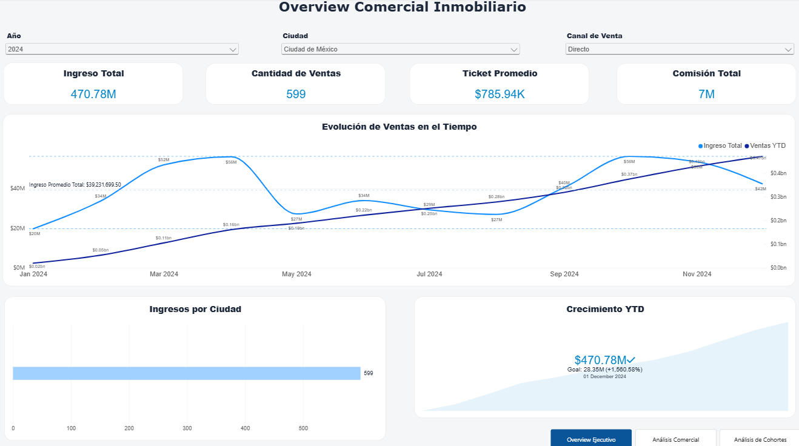
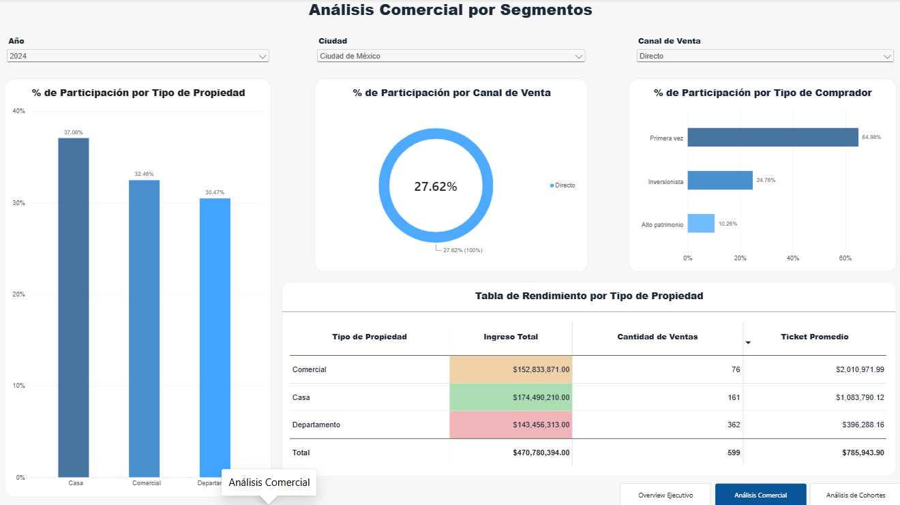
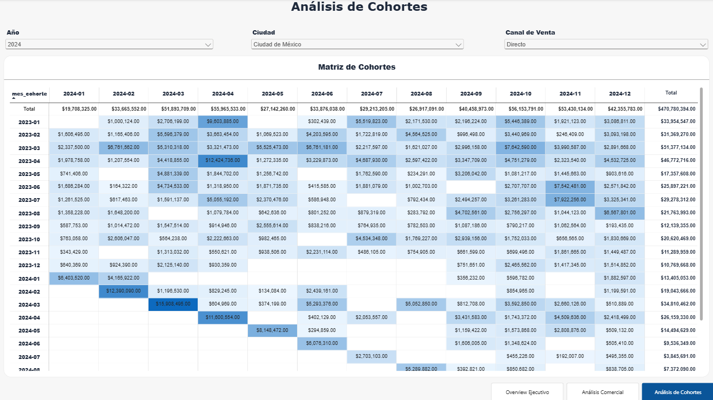

# Grupo Andes | Real Estate Analytics

## Commercial Performance, Segmentation & Cohort Analysis

**Tools:** Power BI | Business Intelligence | Data Visualisation  
**Project type:** Real Estate Analytics Case Study  
**Analysis period:** 2024 dashboard view  
**Focus:** Sales Performance | Property Segmentation | Cohort Analysis

---

## 01. Project Overview

This project examines real estate commercial performance through three interconnected Power BI dashboards.

The analysis focuses on revenue generation, property sales, transaction values, buyer segmentation, sales channels, and revenue patterns across customer cohorts.

The objective is to translate transactional data into actionable commercial insights that can support performance monitoring and strategic decision-making.

## 02. Business Objectives

The project addresses five key questions:

1. How does revenue evolve throughout the year?
2. Which property types generate the highest revenue?
3. How do buyer segments and sales channels contribute to commercial performance?
4. What differences exist between property sales volume and average transaction value?
5. How does revenue vary across acquisition cohorts and subsequent months?

## 03. Dashboard 1 — Executive Overview

The executive dashboard provides a high-level view of:

- Total revenue
- Number of property sales
- Average transaction value
- Total commissions
- Monthly revenue trends
- Year-to-date performance

### Selected Dashboard Results

For the displayed filters (2024, Ciudad de México, Directo):

| KPI | Value |
|---|---:|
| Total Revenue | $470.78M |
| Property Sales | 599 |
| Average Transaction Value | $785.94K |
| Total Commissions | Approximately $7M |

These values represent the selected dashboard view and should not be interpreted as unfiltered company-wide totals.

## 04. Dashboard 2 — Commercial Segmentation

This dashboard examines commercial performance across property categories, buyer profiles, and sales channels.

### Property Performance

| Property Type | Revenue | Sales |
|---|---:|---:|
| Houses | $174.49M | 161 |
| Commercial | $152.83M | 76 |
| Apartments | $143.46M | 362 |

### Initial Findings

- Houses generate the highest revenue among the three property types.
- Apartments account for the largest number of transactions.
- Commercial properties have the highest average transaction value.

These differences highlight the importance of evaluating both sales volume and transaction value when assessing category performance.

## 05. Dashboard 3 — Cohort Analysis

The cohort matrix visualises revenue by cohort month and transaction month.

This allows analysts to investigate:

- Revenue patterns across acquisition cohorts
- Differences in cohort contributions over time
- Concentration of revenue within particular periods
- Potential opportunities for further customer lifecycle analysis

Cohort revenue patterns should not automatically be interpreted as customer retention without validating the underlying cohort definitions and customer-level activity.

## 06. Commercial Applications

The dashboards can support:

- **Sales planning:** Monitoring monthly performance and revenue trends.
- **Portfolio strategy:** Comparing property types by sales volume, revenue, and average transaction value.
- **Customer segmentation:** Understanding the composition of buyer profiles.
- **Channel analysis:** Evaluating commercial performance across sales channels.
- **Cohort monitoring:** Investigating how revenue is distributed across cohorts and transaction periods.

These are potential business applications, not measured outcomes of implementing recommendations.

## 07. Project Files

- `real_estate_overview.png` — Executive Overview dashboard
- `real_estate_commercial.png` — Commercial Segmentation dashboard
- `real_estate_cohorts.png` — Cohort Analysis dashboard

## 08. About the Analyst

Victoria López Vázquez

Commercial merchandising professional transitioning into Data Analytics and Business Intelligence, combining commercial strategy, performance analysis, and data visualisation.

[View my Data Analytics Portfolio](https://vichovska.github.io/)

---

*Portfolio project developed as part of my data analytics training.*
